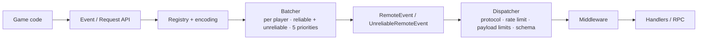

<div align="center">


<p><strong>Typed, server-authoritative networking for Roblox.</strong><br>
Events, RPC, batching, middleware, validation, rate limits and statistics —
without giving up native Roblox remotes.</p>

<p>
<a href="#quick-start"><strong>Quick start</strong></a> &nbsp;·&nbsp;
<a href="BENCHMARKS-SIMPLE.md"><strong>Benchmarks in plain English</strong></a> &nbsp;·&nbsp;
<a href="docs/ARCHITECTURE.md"><strong>Architecture</strong></a> &nbsp;·&nbsp;
<a href="docs/SECURITY.md"><strong>Security</strong></a>
</p>

<p>


</p>

</div>

---

ThunderNet is a networking framework for Roblox experiences that need more than
a `RemoteEvent` wrapper but less than a home-grown protocol. It keeps Roblox's
transport, then adds the layers serious games keep rebuilding: a validated wire
format, per-destination batching with priorities, request/response with safe
retries, middleware, rate limits, optional serialization and compression, and
production-facing statistics.

It is **not** an anti-cheat system and it does **not** make the internet faster.
It is the safety and organization layer between your game code and Roblox
remotes — with its costs measured and documented.

## Why ThunderNet

| | What you get |
| --- | --- |
| **One consistent API** | Events, channels, requests and middleware on both server and client. |
| **Fewer network calls** | Per-destination batching with five priority levels and fairness under load. |
| **Server-authoritative safety** | Payload limits, depth limits, rate limits, schemas, permissions and malformed-packet rejection before dispatch. |
| **RPC you don't have to build** | Unique ids, timeouts, exponential backoff, bounded retries, duplicate-request protection, cancellation and promise integration. |
| **Optional performance layers** | Pluggable middleware, binary serializer and compression codecs, off by default. |
| **Operational visibility** | Message, batch, queue, request, rejection, retry and dispatch-time statistics. |
| **Lifecycle discipline** | Every listener, queue, cache, player bucket and pending request has an owner and a cleanup path. |
| **Typed interface** | Strict Luau modules with typed events (`TypedEvent<T>`) and RPC results (`PromiseOf<T>`). |

## Verified status

| Check | Result |
| --- | --- |
| Automated tests | **182 passed / 0 failed** — Luau CLI with a simulated Roblox environment |
| Strict type analysis | **Clean** — cross-module `luau-analyze --mode=strict` |
| Rojo build | **Succeeds** — dev place + `build/ThunderNet-0.1.0.rbxm` package |
| Distribution package | **Built successfully** — draggable `.rbxm` at `build/ThunderNet-0.1.0.rbxm` |
| GitHub release / Wally | Workflow and manifest included; **not published yet** (no remote/Wally token) |
| Roblox Studio | **Play Solo run completed** — real local server and real remotes, one sample |
| Real internet latency/bandwidth | **Not measured** — no live-player telemetry claimed |

Engine testing also found and fixed a real bug: oversized batches on
`UnreliableRemoteEvent` were silently dropped by Roblox. ThunderNet now sends
unreliable messages one per call by default. See
[Benchmarks, Explained Simply](BENCHMARKS-SIMPLE.md) or the technical
[docs/BENCHMARKS.md](docs/BENCHMARKS.md).

On client startup, the server publishes a protocol version and codec flags;
clients validate them and fail early with a clear error on mismatch. Event
definitions (for example, unreliable events) still need matching options; full
event sync is planned.

## Contents

- [Installation](#installation)
- [Quick start](#quick-start)
- [Core API](#core-api)
- [Configuration](#configuration)
- [Benchmarks](#benchmarks)
- [Testing](#testing)
- [Releasing](#releasing)
- [Architecture](#architecture)
- [Project structure](#project-structure)
- [Examples and docs](#examples-and-docs)
- [Known limitations](#known-limitations)
- [Troubleshooting](#troubleshooting)

---

## Installation

### Option 1 — drag and drop (easiest)

Download the latest `ThunderNet-<version>.rbxm` from **GitHub Releases** and drag
it into Roblox Studio's Explorer under `ReplicatedStorage`. You get a
`ModuleScript` named `ThunderNet`:

```lua
local ThunderNet = require(game:GetService("ReplicatedStorage"):WaitForChild("ThunderNet"))
```

No Rojo or Wally required. The release file is built from this source tree. If
no GitHub Release exists yet, build it locally with `./scripts/package.sh` and
share `build/ThunderNet-<version>.rbxm`.

### Option 2 — Wally

The repo includes a Wally manifest for `pxubordee/thundernet`. Once it is
published, add it to your `wally.toml` and install:

```toml
[dependencies]
ThunderNet = "pxubordee/thundernet@0.1.0"
```

```bash
wally install
```

Map the Wally `Packages` folder into `ReplicatedStorage` (for example
`ReplicatedStorage.Packages`) and require `Packages.ThunderNet`. Publishing is a
manual maintainer step; see [Releasing](#releasing).

### Option 3 — Rojo from source (development)

Clone the repo and serve the development project:

```bash
cd ThunderNet
rojo serve dev.project.json
```

`dev.project.json` maps source, examples and tests for development.
`default.project.json` is the package project used to build the `.rbxm` and the
Wally blob — it is not the place-development project.

Development mapping:

| Source | Destination |
| --- | --- |
| `src/` | `ReplicatedStorage.ThunderNet` |
| `examples/Server.server.luau` | `ServerScriptService.ThunderNetExamples.Server` |
| `examples/Client.client.luau` | `StarterPlayer.StarterPlayerScripts.ThunderNetExample` |
| `tests/` | `ServerScriptService.ThunderNetTests` (remove for production) |

### Option 4 — Creator Store / Toolbox (optional, manual)

Upload `build/ThunderNet-<version>.rbxm` as a model asset if you want Toolbox
distribution. This is not automated and nothing is published there yet.

---

## Quick start

### Server

```lua
local ReplicatedStorage = game:GetService("ReplicatedStorage")
local ThunderNet = require(ReplicatedStorage:WaitForChild("ThunderNet"))

local Net = ThunderNet.Server()

type CombatData = { Damage: number, TargetName: string }

local Combat = Net:CreateEvent("Combat", {
    Priority = "High",
    Schema = ThunderNet.Validator.Table({
        Fields = {
            Damage = ThunderNet.Validator.Number({ Min = 0, Max = 100 }),
            TargetName = ThunderNet.Validator.String({ MaxLength = 32 }),
        },
    }),
}) :: ThunderNet.TypedEvent<CombatData>

Combat.OnServerEvent:Connect(function(player, data)
    -- Re-derive gameplay results here; never trust client numbers.
    Combat:FireAll({
        Damage = math.clamp(data.Damage, 0, 10),
        TargetName = data.TargetName,
    })
end)

Net:OnRequest("Purchase", function(player, request)
    -- Validate price and ownership against server state before granting.
    return { Success = true }
end)
```

### Client

```lua
local ReplicatedStorage = game:GetService("ReplicatedStorage")
local ThunderNet = require(ReplicatedStorage:WaitForChild("ThunderNet"))

local Net = ThunderNet.Client()

type CombatData = { Damage: number, TargetName: string }
type PurchaseResult = { Success: boolean }

local Combat = assert(Net:GetEvent("Combat")) :: ThunderNet.TypedEvent<CombatData>

Combat.OnClientEvent:Connect(function(data)
    print(data.TargetName, data.Damage)
end)

Combat:FireServer({ Damage = 25, TargetName = "Dummy" })

local purchase: ThunderNet.PromiseOf<PurchaseResult> =
    Net:InvokeServer("Purchase", { ItemId = 7 })

purchase:AndThen(function(result)
    print("purchased", result.Success)
end):Catch(function(err)
    warn(err.Code, err.Message)
end)
```

**Shortcuts:** `ThunderNet.Init()` detects server vs client automatically, and
`ThunderNet.Event<T>(Net, name, options)` creates a typed handle without the cast
pattern:

```lua
local Net = ThunderNet.Init({ Preset = "Standard" })
local Combat = ThunderNet.Event<CombatData>(Net, "Combat", { Priority = "High" })
```

**Typing note:** Luau does not allow explicit type arguments on method calls.
Write `local Event = Net:CreateEvent("Name") :: ThunderNet.TypedEvent<T>`, not
`Net:CreateEvent<T>("Name")`. Runtime schema validation is separate from these
compile-time types.

---

## Core API

### Events and priorities

```lua
local event = Net:CreateEvent("Name", {
    Unreliable = false,
    Priority = "Normal", -- Critical | High | Normal | Low | Background
    Schema = ThunderNet.Validator.Table({ ... }),
    Validate = function(data)
        return true
    end,
    Permission = function(player, data)
        return true
    end,
    RateLimit = { Rate = 10, Burst = 20 },
})

event.OnServerEvent:Connect(function(player, data) end) -- server
event.OnClientEvent:Connect(function(data) end)         -- client
event:FireServer(data)                                  -- client → server
event:FireClient(player, data)                          -- server → one player
event:FireAll(data)                                     -- server → all players
event:FireExcept(player, data)                          -- server → all except one
event:FireMany({ playerA, playerB }, data)              -- server → a list
```

Per-call priority overrides: `event:FireClient(player, data, "Critical")`.

**Ordering:** FIFO inside one `(destination, lane, priority)` queue. Different
priorities are deliberately interleaved for fairness — don't split ordered
messages across priorities.

**Channels** group events and share defaults:

```lua
local Combat = Net:CreateChannel("Combat", { Priority = "High" })
local Hit = Combat:CreateEvent("Hit") -- real event name "Combat/Hit"
```

### Unreliable lane

Use `{ Unreliable = true }` on both sides for transient, frequent data such as
cosmetics, effects and non-critical snapshots. Never use it for purchases,
inventory or other state that must not be lost.

Roblox caps an unreliable call (~900 bytes), so ThunderNet sends unreliable
messages **one per call by default** (`UnreliableBatchSize = 1`,
`UnreliableMaxBytes = 900`). Opt-in batching is available but risks engine drops.

### Request/response (RPC)

```lua
-- server
Net:OnRequest("Purchase", function(player, data)
    return { Success = true }
end)

-- client
local result = Net:InvokeServer("Purchase", { ItemId = 1 }):Await()

-- per-request options
local purchase = Net:InvokeServer("Purchase", { ItemId = 1 }, {
    Timeout = 2,
    MaxAttempts = 2,
    Idempotent = false, -- forces one attempt
})

-- several requests at once
local results = ThunderNet.Promise.all({
    Net:InvokeServer("Purchase", { ItemId = 1 }),
    Net:InvokeServer("Purchase", { ItemId = 2 }),
}):Await()
```

- Unique ids, per-attempt timeout, exponential backoff with jitter, bounded
  retries.
- Per-call `RequestOptions`: `Timeout`, `MaxAttempts`, and `Idempotent = false`
  (forces a single attempt). Backoff stays session-configured.
- The receiver caches responses for `DedupeTtl`, so retries never re-execute a
  non-idempotent handler.
- `promise:Cancel()` sends a cancel envelope; late requests are not executed.
- Errors use codes: `TIMEOUT`, `CANCELLED`, `RATE_LIMITED`, `INVALID_PAYLOAD`,
  `NO_HANDLER`, `HANDLER_ERROR`, `PLAYER_LEFT`, `DESTROYED`.
- `Net:InvokeClient(player, name, data)` works symmetrically; client handlers
  receive `(nil, data)`.

### Middleware

```lua
local token = Net:Use(function(context, next)
    -- context: Data, Channel, Kind ("Event" | "Request"), Side, Player, RequestId
    if not allowed(context.Player) then
        return false, "PERMISSION_DENIED"
    end
    context.Data.checked = true
    return next(context) -- exactly once; may pass a replacement context
end)

Net:Unuse(token)
```

Rules: `next()` exactly once; return `false, reason` to reject; throwing an
error drops the event (requests receive a rejection); not calling `next()` is
`MIDDLEWARE_INCOMPLETE`. Middleware is inbound-only per session.

### Batching and priority scheduling

Per-destination reliable and unreliable lanes each hold five priority queues.
`RunService.Heartbeat` flushes every frame by default. Size and byte limits split
batches; a single oversized message is still sent alone. Messages are never
mixed across destinations or lanes. Every non-empty priority is served on each
flush; when the batch budget is small, the longest-waiting priorities are served
first, so no priority starves forever. Optional adaptive batching trades a
little latency for larger batches while the queue is deep.

### Serialization and compression

Both are **off by default**; native Roblox values are used otherwise.

- Binary serializer supports nil, booleans, finite numbers, strings, tables,
  `Vector2`, `Vector3`, `CFrame`, `Color3`, `UDim`, `UDim2`. Instances,
  `EnumItem`, functions and buffers are rejected. Set
  `FallbackToNative = true` to send unsupported payloads natively with a warning
  instead of throwing.
- Decoding is bounds-checked and never throws; it rejects truncated, oversized,
  too-deep and trailing data.
- Compression uses a pluggable `{ Name, Encode, Decode }` codec; the built-in RLE
  codec is tested and only compresses when it saves at least
  `MinSavingsRatio`. Decompression output is capped.

### Security

Server-authoritative checks run before expensive work:

1. Structural packet validation (opcodes, lengths, names, ids, flags, batches).
2. Per-envelope token-bucket rate limits.
3. Lane rules (RPC reliable-only; unreliable events must be declared).
4. Bounded payload decode.
5. Payload walk (types, finite numbers, key types, byte/depth limits, cycles).
6. Per-event rate limits and permissions.
7. Schema/custom validation.
8. Middleware.
9. Handler, under `pcall`.

The framework cannot validate game meaning. Your server must still verify
damage, currency, inventory, prices, ownership and cooldowns independently.

Extra helpers: `Validator.Literal`, `Validator.OneOf` and `Validator.Map` cover
common shapes, while `Permissions.GroupRank`, `Permissions.HasAttribute`,
`Permissions.UserIds` and `Permissions.Compose` cover authorization patterns.

### Statistics

`Net:GetStats()` returns packet/message/batch counters, average batch size,
estimated bytes, compression savings, queue depth, request counts, retries,
timeouts, malformed/dropped/rate-limited/rejected counters, dispatch counts and
time, and message counts per priority. Byte totals are estimates; real network
usage, ping and bandwidth are not claimed. When `Stats = false`, cheap counters
remain and per-packet dispatch timing is skipped.

### Lifecycle

`Net:Destroy()` disconnects remotes and heartbeats, clears queues, caches and
pending requests, and removes the server remotes folder. `Net:After(seconds, fn)`
schedules a timer that is cancelled on destroy. Player removal cleans batcher
queues, pending requests and rate-limit buckets.

---

## Configuration

`Preset = "Minimal" | "Standard" | "Hardened"` merges sensible defaults; explicit
options always win. Minimal disables dispatch timing, tightens retries and
limits; Standard is the default; Hardened tightens payload/rate limits and
dedupe retention.

```lua
local Net = ThunderNet.Server({
    Name = "ThunderNet",
    Preset = "Standard",
    Stats = true,
    Batch = {
        MaxBatchSize = 64,
        MaxBatchBytes = 16384,
        MaxQueueDepth = 32768,
        FlushInterval = 0,
        Adaptive = false,
        MaxLatency = 0.05,
        AdaptiveDepthThreshold = 16,
        UnreliableBatchSize = 1,
        UnreliableMaxBytes = 900,
    },
    Request = {
        Timeout = 5,
        MaxAttempts = 3,
        BackoffBase = 0.5,
        BackoffMax = 8,
        Jitter = 0.2,
        DedupeTtl = 30,
        DedupeMaxEntries = 256,
    },
    RateLimit = { Rate = 120, Burst = 240 },
    Payload = { MaxBytes = 65536, MaxDepth = 8 },
    Limits = {
        MaxBatchMessages = 128,
        MaxNameLength = 128,
        MaxRequestIdLength = 64,
    },
    Serializer = { Enabled = false, FallbackToNative = false },
    Compression = { Enabled = false, Threshold = 256, MinSavingsRatio = 0.9 },
})
```

Invalid configuration throws before remotes are created. All defaults are
validated on construction.

---

## Benchmarks

**Start here if you are not an engineer:** [Benchmarks, Explained Simply](BENCHMARKS-SIMPLE.md)
has plain-language charts, faster/slower comparisons and a decision checklist.

Engine snapshot (one Roblox Studio Play Solo sample; see caveats):

```text
2,000 updates, server → player
ThunderNet   ████████░░░░░░░░░░░░░░░░   0.006 s
Native raw   ████████████████████████   0.017 s

1,000 unreliable updates
Native raw   ██░░░░░░░░░░░░░░░░░░░░░░   0.014 s
ThunderNet   ████████████████████████   0.250 s
```

The full picture:

- **ThunderNet is slower per message** than bare native remotes (~4.55 µs vs
  ~0.85 µs in the engine sample) because it validates, frames and dispatches.
- **It can be faster at volume** by batching many messages into fewer calls.
- **Unreliable bursts are deliberately slower** (one message per call) to avoid
  Roblox's payload-cap drops.
- **Compression** saves bandwidth but costs CPU; it is opt-in.
- **Real network performance is unmeasured** — Studio Play Solo is local. No
  speed multiplier is claimed.

Full methodology: [technical benchmarks](docs/BENCHMARKS.md) ·
simple guide: [BENCHMARKS-SIMPLE.md](BENCHMARKS-SIMPLE.md).

---

## Testing

```bash
./scripts/check.sh   # tests + strict analysis + Rojo build
./scripts/test.sh    # 182-test suite only
node scripts/analyze.mjs
./scripts/package.sh # build the draggable .rbxm
./scripts/bench.sh   # CLI CPU benchmarks
```

The automated suite covers initialization, event delivery, destination
isolation, batching/priority fairness, unreliable enforcement, middleware, RPC
timeouts/retries/dedupe/cancel/per-call options, rate limits, malformed packets,
payload/schema validation, permissions, player cleanup, compression round-trips,
statistics, queue overflow, presets, Promise.all, handshake validation,
serializer fallback and lifecycle cleanup.

The suite runs on a deterministic simulated Roblox environment. A separate
Roblox Studio Play Solo benchmark session verified real remote delivery and
caught the unreliable batching bug; engine runs are not part of `check.sh`.

---

## Releasing

1. Update `VERSION` and `version` in `wally.toml` to the same value.
2. Run `./scripts/check.sh` (it builds the dev place and the `.rbxm` package).
3. Commit, tag `vX.Y.Z`, and push the tag.
4. GitHub Actions builds and attaches `ThunderNet-X.Y.Z.rbxm` to the release.
5. Publish to Wally with `wally publish` (requires a Wally account/token and the
   matching `wally.toml`).
6. Optional: upload the same `.rbxm` to the Creator Store.

The release workflow only runs on pushed `v*` tags and needs a GitHub remote.

---

## Architecture



Outbound: game code → registry → encode (optional serializer/compression) →
per-destination batch → heartbeat flush → transport.

Inbound: transport → structural validation → rate limits → lane rules → decode →
payload walk → schema/permission → middleware → handler; requests additionally
check the dedupe cache and cache their responses.

One `Heartbeat` connection drives `Scheduler` timers, request retries/timeouts and
batcher flushes in order. Every listener is Janitor-managed.

Read more: [docs/ARCHITECTURE.md](docs/ARCHITECTURE.md) ·
[docs/PROTOCOL.md](docs/PROTOCOL.md) · [docs/SECURITY.md](docs/SECURITY.md).

---

## Project structure

```text
ThunderNet/
├── assets/                     thundernetlogo.png
├── src/                        framework source
├── examples/                   Server and client examples
├── tests/                      Specs, support, CLI runner, Studio runner
├── benchmarks/                 CLI CPU benchmark, Studio benchmark script
├── scripts/                    embed / test / analyze / bench / check / build / package
├── docs/                       Architecture, protocol, security, benchmarks
├── .github/workflows/          Tag-driven release workflow
├── default.project.json        Package project (builds the .rbxm)
├── dev.project.json            Development place project (src + examples + tests)
├── wally.toml                  Wally package manifest
├── VERSION                     Release version
├── LICENSE                     MIT
├── BENCHMARKS-SIMPLE.md        Beginner-friendly benchmark guide
└── README.md
```

## Examples and docs

| Resource | What it covers |
| --- | --- |
| [examples/Server.server.luau](examples/Server.server.luau) | Channels, schema validation, middleware, authoritative handlers, RPC, unreliable snapshots |
| [examples/Client.client.luau](examples/Client.client.luau) | Typed events, unreliable events, calls, RPC promise handling |
| [BENCHMARKS-SIMPLE.md](BENCHMARKS-SIMPLE.md) | Plain-language benchmarks, win/loss table and a native-vs-ThunderNet checklist |
| [docs/BENCHMARKS.md](docs/BENCHMARKS.md) | Methodology, CLI tables, engine Play Solo tables, caveats |
| [docs/ARCHITECTURE.md](docs/ARCHITECTURE.md) | Module responsibilities, data flow, lifecycle, trade-offs |
| [docs/PROTOCOL.md](docs/PROTOCOL.md) | Envelope layouts, opcodes, flags, validation, request lifecycle |
| [docs/SECURITY.md](docs/SECURITY.md) | Threat model, check ordering, limits, dedupe trade-offs |
| [docs/ROADMAP.md](docs/ROADMAP.md) | Shipped capabilities and the planned performance/simplicity/feature milestones |

---

## Known limitations

| Limitation | What it means |
| --- | --- |
| `FireAll` sends per-player batches | Correct isolation, but not a single native broadcast call. |
| Dedupe is time- and size-bounded | A retry after `DedupeTtl`/eviction can re-execute; keep the window above your retry horizon. |
| Middleware is inbound-only | No outbound middleware pipeline in this version. |
| Binary serializer excludes Instances/EnumItems | Use native mode when payloads contain Roblox references. |
| Unreliable messages default to one per call | Prevents engine drops from the ~900-byte cap; opt-in batching is at your own risk. |
| RLE is simple | Opt-in and gated on measured savings; not a modern compressor. |
| Stats are estimates | Payload measurement, not real wire bytes, ping or bandwidth. |
| CLI tests are a simulation | Engine behavior was sampled once in Studio; it is not a CI test suite. |
| No real-network benchmark | Live latency, loss and bandwidth require telemetry with real players. |
| Queue cap drops new messages when full | `MaxQueueDepth` applies per lane and rejects new messages (all priorities) until the queue drains; tune it and watch `QueueOverflow`. |

## Troubleshooting

- **Remotes not found** — create `ThunderNet.Server()` before clients call
  `ThunderNet.Client()`; both must use the same `Name`.
- **Name already exists** — another session with that name is alive. Destroy it or
  use a unique `Name`.
- **Messages disappear** — inspect `GetStats()`: `MalformedPackets`,
  `DroppedPackets`, `PayloadRejected`, `RateLimited`, `PermissionsDenied`.
- **`INVALID_PAYLOAD`** — startup handshake catches protocol/codec mismatches;
  payloads must still fit limits and supported types.
- **Serializer throws on a type** — Instances, EnumItems, functions and buffers
  cannot be binary-serialized; switch to native mode.
- **Requests time out** — handlers must return promptly; tune `Request` timeouts
  and keep `DedupeTtl` above the retry horizon.
- **`MIDDLEWARE_INCOMPLETE`** — every middleware must call `next(context)` once
  or return `false, reason`.
- **Ordering surprises** — messages on different priorities are interleaved;
  keep ordered messages on one priority.
- **Studio runner failures** — it only runs synchronous specs; use
  `scripts/test.sh` for the full suite.

---

<div align="center">
<p><strong>ThunderNet</strong> · built for serious Roblox experiences.</p>
<p>
<a href="#quick-start">Quick start</a> ·
<a href="BENCHMARKS-SIMPLE.md">Plain-English benchmarks</a> ·
<a href="docs/SECURITY.md">Security model</a> ·
<a href="docs/ARCHITECTURE.md">Architecture</a>
</p>
</div>
